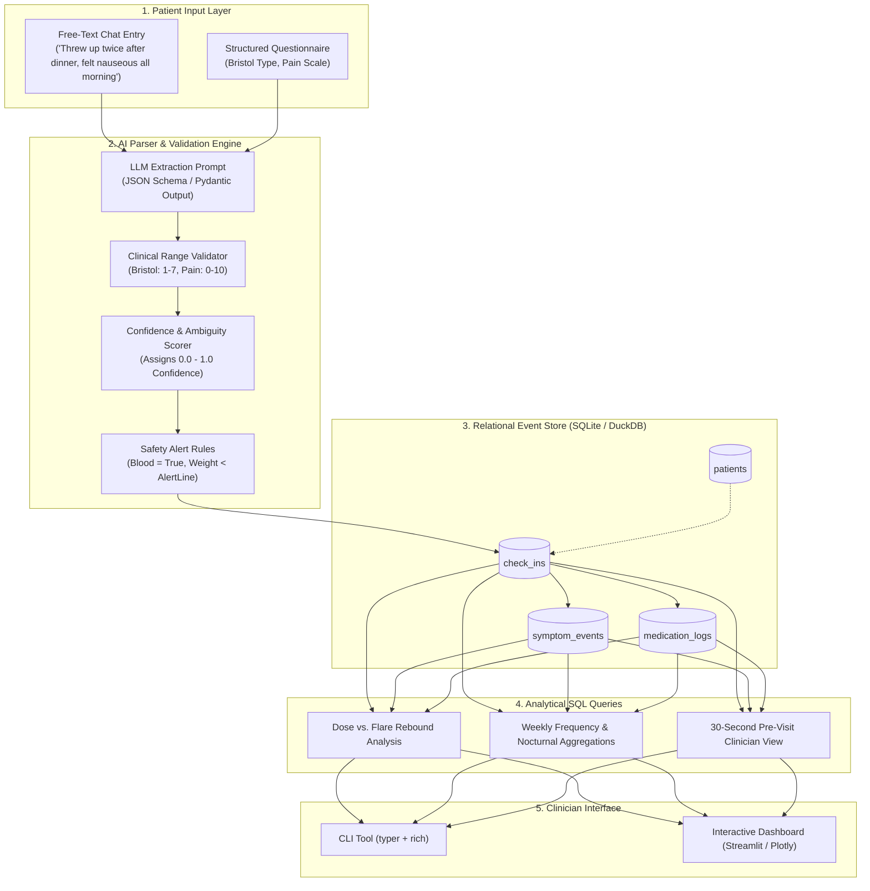

# Pipeline Securities: Assessment Dossier, Reverse-Engineered Findings & Track B Specification

**Document Version**: 1.0  
**Target Position**: Data Intelligence Engineering Intern  
**Company**: Pipeline Securities Inc. / Pipeline Securities India Pvt Ltd.  
**Focus Product**: Dr.Tracker  
**Selected Project Track**: **TRACK B – Patient-Reported Data: Store, Manage & Chart**  
**Repository Working Directory**: `/Users/chielerli/programming/pipeline-demo`

---

## 1. Executive Summary & Assessment Guidelines

### 1.1 Context & Objectives
Pipeline Securities is evaluating candidates on their ability to:
1. Work with messy, real-world healthcare data.
2. Build practical AI-powered workflows with rigorous validation.
3. Design clean data storage and time-series aggregation.
4. Explain technical decisions and trade-offs clearly to both engineering and non-technical/clinical stakeholders.

### 1.2 Interview & Presentation Format
* **Total Duration**: Approximately 30 minutes.
  * **0:00 – 0:05 (5 mins)**: Candidate introduction and background.
  * **0:05 – 0:20 (15 mins)**: Live screen-share demonstration of the working prototype and design walkthrough.
  * **0:20 – 0:30 (10 mins)**: Technical Q&A, design trade-offs, confidence handling, and AI guardrails discussion.
* **Submission Deadline**: The prototype link (GitHub repository, notebook, or live demo) must be submitted via the submission form **at least 24 hours prior** to the scheduled interview slot.
* **Evaluation Dimensions**:
  * **Problem Understanding**: Addressing true practice workflows (preventing cognitive fatigue for doctors).
  * **Data Handling**: Clean, relational/event-based modeling, data normalization, schema constraints.
  * **AI Proficiency**: Using LLMs where they add genuine value (extraction, structured JSON), implementing strict output validation, and knowing healthcare boundaries.
  * **Communication**: Clear architectural defense and articulation of design trade-offs.
  * **Clinical Judgment**: Privacy-aware choices (HIPAA/PHI separation), handling missing/vague data, and avoiding unsupported diagnostic claims.

---

## 2. Comprehensive Link & External Resource Directory

All external hyperlinks from the assessment brief, application forms, and live web assets were fetched, inspected, and verified:

| Resource Name | URL | Status & Verified Contents |
| :--- | :--- | :--- |
| **Demo Showcase Portal** | [https://demo.pipelinesecurities.net/showcase/](https://demo.pipelinesecurities.net/showcase/) | Public entry point featuring 3 interactive Dr.Tracker sandbox demos (Dermatology, Gastroenterology, Oncology). |
| **Gastroenterology Demo** | [https://demo.pipelinesecurities.net/c/48kyqf](https://demo.pipelinesecurities.net/c/48kyqf) | **Primary benchmark for Track B**: Patient Maya Patel on an 8-week Prednisone taper (40mg → 0mg). Includes stool tracking, Bristol scale, visible blood detection, and colonoscopy prep. |
| **Oncology Demo** | [https://demo.pipelinesecurities.net/c/ffhz57](https://demo.pipelinesecurities.net/c/ffhz57) | Patient James on 33 radiation sessions + weekly cisplatin. Tracks oral mucositis (0–4 scale), pain (0–10 NRS), swallowing capacity, and weight with an explicit alert line (165 lb). |
| **Dermatology Demo** | [https://demo.pipelinesecurities.net/c/8c9413](https://demo.pipelinesecurities.net/c/8c9413) | Patient Emma Clarke on a 120-day Isotretinoin course. Tracks facial dryness, chapped lips, joint pain (severity ≥ 4 flag), and bloodwork reminders. |
| **Corporate Website** | [https://pipelinesecurities.com/](https://pipelinesecurities.com/) | Clinical-grade data infrastructure, AI-native Electronic Data Capture (EDC) for clinical trials, and Dr.Tracker for private practices. Research partners: Northwell Health, Johns Hopkins, AIIMS. |
| **Interview Scheduling** | [https://calendar.app.google/gBeFJk2Rmdqbmnpu8](https://calendar.app.google/gBeFJk2Rmdqbmnpu8) | Google Calendar slot booking for candidate interviews. |
| **Candidate Submission Form** | [https://docs.google.com/forms/d/e/1FAIpQLSfu_MCHzn140tY11evSZxYbHSGv6qZbpKBcfoSu4to7Cd7KDQ/viewform](https://docs.google.com/forms/d/e/1FAIpQLSfu_MCHzn140tY11evSZxYbHSGv6qZbpKBcfoSu4to7Cd7KDQ/viewform) | Required fields: Acknowledgement of PoC scope, Confidentiality & IP consent, Track selection (A, B, or C), Assignment link, Interests. |
| **Practice Demo Booking** | [https://pipelinesecurities.zohobookings.com/5011283000000038045/](https://pipelinesecurities.zohobookings.com/5011283000000038045/) | Zoho Bookings widget used across Dr.Tracker CTA buttons for real prospective clinics. |

---

## 3. Reverse-Engineering Dr.Tracker: Production Architecture & Schemas

By analyzing the production bundle (`index-MVwI-hij.js`, 678 KB) and HTML templates on `demo.pipelinesecurities.net`, we extracted the internal data models, scoring rubrics, and clinical logic that Pipeline Securities built into Dr.Tracker.

### 3.1 Design Philosophy & UI Rules
1. **The "30-Second Clinician Rule"**: Providers have under 30 seconds before walking into an exam room. The UI does not show walls of text; it presents:
   * **Alert Banners**: Immediate red alerts (e.g., visible blood in stool, weight dropping below the clinic's alert line).
   * **Directional Trajectory**: Is the symptom trend worsening, steady, or improving?
   * **Medication Correlation**: Did symptoms flare after the dose stepped down?
2. **Strict Verbatim Auditability**: The clinic console explicitly notes:  
   *"Every column is something a patient reported. Nothing here was scored or inferred."*  
   Doctors must be able to click on any point on a chart or card to inspect the patient's exact verbatim words.

---

### 3.2 Clinical Scenario Deep Dives

#### A. Gastroenterology: IBD Flare on Prednisone Taper (`oneoff_gastro_ibd`)
* **Patient**: Maya Patel (34 y/o female, Day 22 of 56).
* **Treatment Plan**: Prednisone taper 40mg → 0mg over 8 weeks (-5mg weekly step-down) + Folic acid 1mg daily.
* **Taper Steps**:
  * Week 1: 40 mg
  * Week 2: 35 mg
  * Week 3: 30 mg
  * Week 4: 25 mg (Current step)
  * Week 5: 20 mg
  * Week 6: 15 mg
  * Week 7: 10 mg
  * Week 8: 5 mg
  * End: 0 mg
* **Clinical Metrics**:
  * **Bristol Stool Form Scale (1–7)**: Baseline flare avg 6.4 (mushy/loose); target is 3–4 (typical normal).
  * **Visible Blood**: Binary flag. Critical alert sent to clinic console on save.
  * **Nocturnal Diarrhea / Urgency**: Tracked separately from daytime bowel movements (e.g. *"Woke me up twice tonight, really urgent"*). Nocturnal awakening is a clinical marker distinguishing active inflammatory flares from functional symptoms.
  * **Abdominal Cramping Quadrants**: `Lower left`, `Lower right`, `Around navel`, `Upper abdomen`, `All over`.
  * **Steroid Side Effects**: Insomnia/trouble sleeping (46%), Increased appetite (38%), Mood swings (24%), Heartburn (15%), Fluid retention (11%).
* **Console Metrics**: 38 check-ins, 31 photos, 12 nocturnal events, 3 critical flags.

#### B. Oncology: Head & Neck Radiation + Cisplatin (`ffhz57`)
* **Patient**: James (Oral cavity cancer, Week 4 of 7, Radiation session 18 of 33 + weekly cisplatin).
* **Clinical Metrics**:
  * **Mouth Sores (Oral Mucositis)**: 5-level scale:
    * `0`: None
    * `1`: Mild
    * `2`: Sores · soft food OK
    * `3`: Sores · liquids only
    * `4`: Can't eat or drink
  * **Pain Score**: 0–10 Numeric Rating Scale (NRS). Flagged if ≥ 7 or sudden delta.
  * **Swallowing Capability**: `Solids` → `Soft food` → `Liquids only` → `Nothing`.
  * **Associated Symptoms**: Dry mouth (xerostomia), Taste change (dysgeusia), Thick saliva, Fever.
  * **Weight Tracking with Alert Line**: Baseline 172 lb; clinic alert threshold set at 165 lb. Current weight 163.6 lb triggers a critical flag: *"Down 8.4 lb since day 1. Dr. Whitaker's team has been notified."*

---

## 4. Track B Specification & Engineering Blueprint

### 4.1 System Architecture



---

### 4.2 Handling Vague and Conflicting Reports

A major requirement in the brief is explaining how the system handles vague or conflicting patient reports:

| Report Type | Example Raw Input | Parser Behavior & Strategy |
| :--- | :--- | :--- |
| **Vague Report** | *"Felt awful all morning, stomach is acting up again."* | • Flags `is_vague = True`.<br>• Confidence score set low (e.g. `0.35`).<br>• **Does NOT invent a Bristol score or severity level** (keeps `null`).<br>• Logs qualitative symptom `stomach upset` for the provider to see. |
| **Conflicting Report** | *"No pain at all today, but my gut was cramping so badly I could barely walk."* | • Flags `has_conflicting_data = True`.<br>• Confidence reduced (e.g. `0.55`).<br>• Follows clinical safety triage: records cramping severity, flags record with reason: *"Patient reported zero pain but high cramping disability"*. |
| **Multi-Symptom Report** | *"Threw up twice after lunch, dizzy, and woke up at 3am with urgent diarrhea."* | • Splits into multiple child `symptom_events` tied to one parent `check_in`:<br>  1. Vomiting (count: 2, timing: postprandial)<br>  2. Dizziness<br>  3. Stool (nocturnal: true, urgency: true). |
| **Critical Flag** | *"Woke up twice tonight, and I think there was blood again."* | • Triggers `is_critical_flag = True`, `flag_reason = 'Visible blood in stool'`.<br>• Surfaces to the top of the provider console immediately. |

---

### 4.3 Relational Database Schema (SQLite DDL)

```sql
-- Patients master table
CREATE TABLE IF NOT EXISTS patients (
    patient_id TEXT PRIMARY KEY,
    full_name TEXT NOT NULL,
    dob DATE NOT NULL,
    specialty TEXT NOT NULL CHECK(specialty IN ('gastro', 'oncology', 'derm')),
    protocol_name TEXT NOT NULL,
    baseline_date DATE NOT NULL,
    baseline_weight_lb REAL,
    weight_alert_threshold_lb REAL,
    created_at DATETIME DEFAULT CURRENT_TIMESTAMP
);

-- Check-ins table (captures verbatim input, confidence, and audit trail)
CREATE TABLE IF NOT EXISTS check_ins (
    checkin_id TEXT PRIMARY KEY,
    patient_id TEXT NOT NULL REFERENCES patients(patient_id) ON DELETE CASCADE,
    timestamp DATETIME NOT NULL,
    raw_text TEXT NOT NULL,
    parser_confidence REAL NOT NULL CHECK(parser_confidence BETWEEN 0.0 AND 1.0),
    parsing_status TEXT NOT NULL CHECK(parsing_status IN ('valid', 'ambiguous', 'flagged_for_review')),
    has_conflicting_data BOOLEAN DEFAULT 0,
    ambiguity_notes TEXT,
    is_critical_flag BOOLEAN DEFAULT 0,
    flag_reason TEXT,
    created_at DATETIME DEFAULT CURRENT_TIMESTAMP
);

-- Granular symptom events (1 check-in can have N symptom events)
CREATE TABLE IF NOT EXISTS symptom_events (
    event_id TEXT PRIMARY KEY,
    checkin_id TEXT NOT NULL REFERENCES check_ins(checkin_id) ON DELETE CASCADE,
    symptom_category TEXT NOT NULL CHECK(symptom_category IN ('stool', 'pain', 'vomiting', 'nausea', 'mucositis', 'swallowing', 'general')),
    primary_metric_name TEXT,     -- 'bristol_score', 'pain_nrs', 'vomiting_count'
    primary_metric_value REAL,    -- 1 to 7 (Bristol), 0 to 10 (Pain NRS), etc.
    severity_label TEXT,          -- 'Mild', 'Moderate', 'Severe'
    body_site TEXT,               -- 'Lower left', 'Oral cavity', 'Around navel'
    nocturnal_episode BOOLEAN DEFAULT 0,
    visible_blood BOOLEAN DEFAULT 0
);

-- Medication adherence & side effects
CREATE TABLE IF NOT EXISTS medication_logs (
    med_log_id TEXT PRIMARY KEY,
    checkin_id TEXT NOT NULL REFERENCES check_ins(checkin_id) ON DELETE CASCADE,
    medication_name TEXT NOT NULL,
    planned_dose_mg REAL,
    actual_dose_mg REAL,
    taper_step_number INTEGER,
    adherence_status TEXT NOT NULL CHECK(adherence_status IN ('taken', 'missed', 'delayed')),
    reported_side_effects TEXT    -- JSON array of strings: '["insomnia", "mood_change"]'
);

-- Indexing for speed and time-series queries
CREATE INDEX IF NOT EXISTS idx_checkins_patient_time ON check_ins(patient_id, timestamp);
CREATE INDEX IF NOT EXISTS idx_symptoms_category ON symptom_events(symptom_category);
CREATE INDEX IF NOT EXISTS idx_med_taper ON medication_logs(medication_name, taper_step_number);
```

---

### 4.4 Pydantic v2 Parsing Schema

```python
from pydantic import BaseModel, Field, field_validator
from typing import List, Optional
from datetime import datetime
from enum import Enum

class SwallowingLevel(str, Enum):
    SOLIDS = "Solids"
    SOFT_FOOD = "Soft food"
    LIQUIDS_ONLY = "Liquids only"
    NOTHING = "Nothing"

class AdherenceStatus(str, Enum):
    TAKEN = "taken"
    MISSED = "missed"
    DELAYED = "delayed"

class ExtractedSymptomReport(BaseModel):
    timestamp: datetime
    raw_text: str
    
    # Specific Clinical Indicators
    bristol_stool_score: Optional[int] = Field(None, ge=1, le=7, description="Bristol score 1-7")
    pain_score_nrs: Optional[int] = Field(None, ge=0, le=10, description="Pain score 0-10")
    vomiting_episodes: Optional[int] = Field(None, ge=0, description="Count of vomiting episodes")
    swallowing_capacity: Optional[SwallowingLevel] = None
    
    # Flags and Qualifiers
    visible_blood: bool = Field(False, description="Whether blood was observed in stool/vomit")
    nocturnal_awakening: bool = Field(False, description="Woke from sleep due to symptom")
    cramping_quadrants: List[str] = Field(default_factory=list, description="Anatomical quadrants")
    
    # Medication tracking
    medication_name: Optional[str] = None
    dose_mg: Optional[float] = None
    adherence: AdherenceStatus = AdherenceStatus.TAKEN
    reported_side_effects: List[str] = Field(default_factory=list)
    
    # Confidence and Safety Triage
    confidence_score: float = Field(..., ge=0.0, le=1.0)
    has_conflicting_data: bool = False
    ambiguity_notes: Optional[str] = None
    is_critical_flag: bool = False
    flag_reason: Optional[str] = None

    @field_validator("confidence_score")
    def validate_confidence(cls, v):
        if v < 0.5:
            # Low confidence reports must never fabricate exact numeric metrics
            pass
        return v
```

---

### 4.5 Key Analytical SQL Queries

#### Query 1: Taper Step vs. Symptom Rebound (Detecting Taper Failure)
*Shows how patient symptoms react as steroid dose steps down:*
```sql
SELECT 
    m.actual_dose_mg AS prednisone_dose_mg,
    COUNT(DISTINCT c.checkin_id) AS total_checkins,
    ROUND(AVG(s.primary_metric_value), 2) AS avg_bristol_score,
    SUM(CASE WHEN s.visible_blood = 1 THEN 1 ELSE 0 END) AS days_with_blood,
    SUM(CASE WHEN s.nocturnal_episode = 1 THEN 1 ELSE 0 END) AS nocturnal_episodes,
    GROUP_CONCAT(DISTINCT m.reported_side_effects) AS active_side_effects
FROM medication_logs m
JOIN check_ins c ON m.checkin_id = c.checkin_id
JOIN symptom_events s ON c.checkin_id = s.checkin_id
WHERE m.medication_name LIKE '%Prednisone%'
GROUP BY m.actual_dose_mg
ORDER BY m.actual_dose_mg DESC;
```

#### Query 2: The 30-Second Pre-Visit Clinician Card
*Provides the instant snapshot a doctor needs before entering the room:*
```sql
SELECT 
    p.full_name,
    p.protocol_name,
    COUNT(c.checkin_id) AS total_checkins_last_14d,
    SUM(CASE WHEN c.is_critical_flag = 1 THEN 1 ELSE 0 END) AS pending_critical_flags,
    ROUND(AVG(CASE WHEN s.primary_metric_name = 'bristol_score' THEN s.primary_metric_value END), 1) AS recent_avg_bristol,
    ROUND(AVG(CASE WHEN s.primary_metric_name = 'pain_nrs' THEN s.primary_metric_value END), 1) AS recent_avg_pain,
    MAX(c.timestamp) AS last_checkin_timestamp,
    (SELECT raw_text FROM check_ins WHERE patient_id = p.patient_id ORDER BY timestamp DESC LIMIT 1) AS latest_patient_quote
FROM patients p
LEFT JOIN check_ins c ON p.patient_id = c.patient_id AND c.timestamp >= datetime('now', '-14 days')
LEFT JOIN symptom_events s ON c.checkin_id = s.checkin_id
WHERE p.patient_id = :target_patient_id
GROUP BY p.patient_id;
```

---

## 5. Implementation Roadmap & File Plan

To complete the Track B deliverables for the interview submission:

1. **`generate_synthetic_data.py`**:
   * Generates longitudinal data (4–8 weeks) for 3–5 fictional patients.
   * Produces realistic messy text, typos, vague phrases, conflicting logs, and emergency red flags.
2. **`parser.py`**:
   * Implements the Pydantic parser with regex/LLM extraction, confidence scoring, and safety triggers.
3. **`db.py`**:
   * Initializes SQLite schema, executes ingestion, and runs the analytical SQL queries.
4. **`cli.py`**:
   * Rich CLI tool (`typer` + `rich`) allowing users to:
     * `python cli.py parse "text"`: Test real-time extraction.
     * `python cli.py ingest`: Populate database.
     * `python cli.py summary <patient_id>`: Display 30-second clinician card.
     * `python cli.py query taper-trend`: Run dose-response query.
5. **`app.py`**:
   * Lightweight Streamlit or Plotly web dashboard matching the Dr.Tracker clinic console layout.
