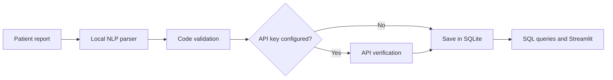

# Track B prototype design

**Status:** Reduced scope agreed by Codex and Claude Opus after a narrowing review. The local prototype is implemented; see README.md for commands and docs/validation-examples.md for checks and known misses. This document supersedes the earlier, more elaborate design.

## Goal

Demonstrate one working path: patient free text → structured symptom records → SQLite → a provider's symptom chart. Use the oncology demo as context, the existing synthetic dataset, a local NLP parser, and optional API verification.

The presentation should explain what patients reported, how extraction was checked, and what patterns the provider can see. This is an assessment prototype, not a production clinical system.

## Dataset

Keep the existing three synthetic patients across four weeks: 84 scheduled daily check-ins, 78 submitted reports, and six deliberately missing entries. Keep symptom variation beyond nausea/vomiting, including fatigue, dizziness, breathlessness, and fainting.

Structured symptom and medication facts were generated first; patient check-ins were drafted second. Expected extraction labels contain only information visible in the text or questionnaire. A separate AGY agent reviewed the dataset. These are agent-reviewed synthetic labels, not human-verified records.

Use [the dataset manifest](../../../data/synthetic/README.md) and [QA report](../../../data/synthetic/review.md) for details. Do not regenerate or expand the dataset. Latent generation facts and expected labels are evaluation material, never parser input.

## Workflow

1. Preserve the original report with its patient ID and submission time.
2. Run the local parser to extract symptom mentions, severity, frequency, timing, and medications where stated.
3. Validate field types, supported values, and source evidence.
4. If an API key is configured, send the original text and local extraction for a structured verification check. Otherwise use the local result directly.
5. Save results and any review flags in SQLite.
6. Query the stored observations and display the patient's trends.

Questionnaire values are read directly in code rather than sent through NLP. Text extraction stays separately inspectable and is evaluated independently; questionnaire values must not conceal text-parser errors. A parser failure keeps the original report and displays the error.

## Parser and optional verification

Use one local pipeline: **medspaCy with a small symptom/synonym list and extraction rules**. medspaCy is a clinical NLP toolkit; this baseline is primarily rule-based, not a pretrained model that understands arbitrary medical language. Rules cover our symptom vocabulary and common phrases, context such as negation, explicit counts, stated severity, and simple dates.

Do not add a second local model or train a custom model. Broader recognition is a limitation to measure and explain. Preserve original text even when the parser misses a symptom; preserve unmatched candidate phrases when detected, without promising recognition of every unseen symptom.

The optional API verifier checks the original report against the local output and returns agreement, disagreements, or missed observations with evidence. It can identify issues the local rules miss, but it is not ground truth.

Keep the local extraction as the baseline. Store verification feedback as JSON on the report and mark disagreements for inspection; do not automatically rewrite chart data or exclude otherwise eligible counts based on the verifier's opinion. Keep verifier disagreement separate from local parsing issues that make a count unusable. API feedback can be inspected beside the original text. No extra verification table or adjudication interface is needed.

Without a key, label verification “not run.” On API failure, retain the local result and show “verification unavailable.” Do not block the demo. The implementation uses a configurable OpenAI-compatible endpoint, with gpt-4.1-mini as the default model. Verification runs explicitly for a selected report to avoid background charges. Do not store API keys in SQLite or commit them to the repository.

## SQLite schema

Use a small relational schema with four tables, not a dimensional warehouse.

| Table | Fields |
|---|---|
| patients | patient_id, synthetic name, age, start_date |
| reports | report_id, patient_id, submitted_at, report_date, raw_text, questionnaire_json, parser_version, review_needed, issues_json, verification_json |
| symptom_observations | observation_id, report_id, source (text or questionnaire), symptom, original_phrase, presence, severity_value, severity_scale, severity_text, episode_count, observed_date, timing_text, medication_mentioned, evidence, issues_json |
| medication_events | event_id, patient_id, optional report_id, medication, dose/unit if stated, effective_date, event_type, source |

Import only the existing structured regimen fixture records into medication_events: started maps to start and discontinued maps to stop. Do not import generated administration facts as if patients reported them. Patient-text medication mentions stay in extracted observations; no adherence-analysis feature is needed. Never import latent ground_truth_events.json into the application store. A missed dose is not a prescribed regimen change.

Unknown fields are NULL. Add symptoms as rows, not new columns. Related medications and side effects are recorded only as stated associations; do not predict causes. Additional dataset demographics and optional weight fields do not need to enter the application schema.

Stable source IDs prevent duplicate imports. A simple rebuild/import command is enough; no extraction-history or general correction system is required. Use the dataset study start date (2026-10-05), a fixed 28-day schedule, and one documented timezone constant. Keep verification status inside verification_json rather than adding status columns.

## Handling messy reports

Keep the rules short and visible:

| Input or issue | Prototype behavior |
|---|---|
| “Threw up twice after dinner” | Vomiting present, count 2, timing phrase retained |
| “Mild nausea” | Qualitative severity retained; no invented numeric score |
| “A few times” or “2–3 times” | Retain wording; exact episode_count stays NULL |
| “No vomiting today” | Explicit absence and count 0 |
| Symptom not mentioned / no check-in | Unknown, never converted to zero |
| “Nauseous this morning, fine tonight” | Present that day; evening absence does not erase it |
| Clear “yesterday” reference | Resolve against the submission date using a consistent documented dataset timezone |
| Unclear date or multi-day total | Retain timing text; exclude from daily exact totals |
| Contradictory questionnaire and text | Preserve both inputs; flag affected observation, without choosing a winner |
| Multiple overlapping or conflicting counts | Flag affected counts and exclude them from exact totals |
| Clear within-report correction | Use the explicitly corrected value, not the sum of old and new values |
| Unknown medication or symptom mapping | Retain phrase and flag uncertainty |

Questionnaire daily numbers are the default recorded values for the day they cover. Store text claims separately, never add their counts to questionnaire totals, and show the source in the report drilldown. A partial text count at or below the questionnaire total is compatible. An explicit conflicting full-day total or a partial count above the questionnaire total flags the affected count and excludes it from exact aggregation. Missing or unanswered questionnaire values remain unknown; the dataset's questionnaires happen to be complete.

When an observation day has no questionnaire, a sole explicit text count can contribute documented episodes, not an exhaustive full-day total. Multiple unsupported or overlapping text counts are flagged rather than summed. Presence and count certainty remain separate.

Group symptoms by observed_date, not submission/report date. For example, patient 101's Day 13 report describes two episodes on Day 12: they belong on Day 12 while Day 12 remains missing in submission coverage. Day 13's questionnaire zero applies only to Day 13.

No dedicated correction chains, day-ownership algorithm, generalized temporal reasoning, clinical alerts, or human review workflow is included. Flag unsupported cases and expose the original evidence.

## Two SQL queries

1. **Weekly symptoms:** Group by patient, study week, and symptom. Return reported symptom days and documented episode counts, plus reporting coverage and the number of excluded/unknown counts. Count distinct symptom days rather than observation rows. Exclude affected unresolved counts; do not describe partial counts as a complete weekly total.
2. **Before/after a medication change:** For an explicit regimen change fixture, compare seven days before with seven days after, excluding the change day. Show symptom days, documented episodes, and reporting coverage. Use the existing interior dataset change date; skip boundary/generalized window handling. No change means no comparison. Describe association, not treatment efficacy.

These can be ordinary SQL queries. No mandatory analytical views, warehouse, or generalized metric layer is needed. Query results must come from the parsed SQLite data, not expected annotations or narrative fixture totals.

## One Streamlit page

- Patient selector and a short reporting-coverage summary.
- Symptom-presence chart over time and documented vomiting counts, with the medication-change date marked.
- Weekly symptom summary and a small before/after comparison.
- Expandable table of original reports, extracted fields, review flags, and optional verification feedback.

Use the loaded dataset for the demonstration. No live submission form, separate input tab, clinical triage, weight dashboard, or record-editing interface is required. Missing reports and unknown counts must not appear as symptom-free zeroes.

## Validation and presentation

Use the existing development/evaluation split. Check a small representative set of extraction outputs against the annotations, including negation, vague counts, dates, symptom variation, and conflicts. Report concrete examples of correct results and failures; a full benchmarking suite is unnecessary.

Code validates the schema, numeric ranges, and source evidence. Verifier suggestions must also cite actual source evidence. Neither a matching quote nor API agreement proves that a claim was interpreted correctly. If API verification is exercised, show a few useful agreements/disagreements rather than building a second evaluation project. Questionnaire inputs are explicitly separate from text inputs; do not count directly read questionnaire values as NLP extraction successes. Clear numerical corrections remain text-parser checks even when questionnaire values keep the chart correct.

Keep patient SYN-PT-103's labels out of prompt/rule tuning. Explain that agent-generated labels can share systematic errors with the parser or verifier. A few reported examples do not establish general clinical accuracy or arbitrary unseen-symptom detection.

## Scope boundary and completion

Build only the dataset importer, local parser, optional API verifier, four-table SQLite store, two SQL queries, and one Streamlit page. Use synthetic data only. All core functionality works without API credentials; any hosted verification call is optional and may incur provider charges.

The prototype is complete when those pieces run end to end and we can explain the schema, extraction limitations, validation examples, two query results, and chart in the presentation. Check medspaCy compatibility with the chosen Python version when implementation starts and pin working dependencies. Further models, reconciliation systems, extensive audit trails, and production hardening are out of scope.
